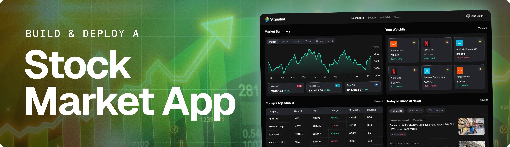
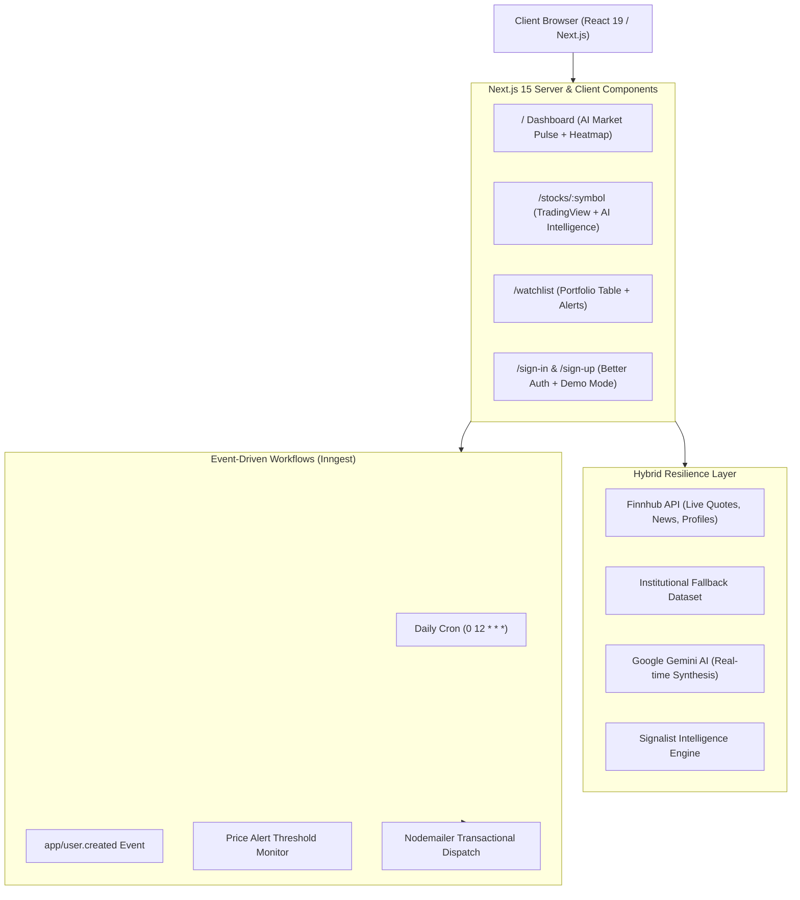

# 🚀 Signalist: AI-Powered Real-Time Stock Market Platform
### *Resume Project Portfolio Guide & Technical Architecture*



---

## 📄 Resume Bullet Points (Copy & Paste Ready)

### Option 1: Full-Stack / Software Engineering (SWE)
* **Architected and deployed a full-stack, real-time financial tracking platform** using **Next.js 15 (App Router)**, **TypeScript**, and **Tailwind CSS**, serving sub-second market data, interactive TradingView charts, and technical indicators.
* **Engineered an asynchronous, event-driven workflow engine** with **Inngest**, automating scheduled daily news digests, automated price-threshold alerts, and personalized investor onboarding workflows.
* **Integrated Google Gemini 1.5/2.5 AI** to deliver real-time sentiment analysis, Wall Street bull/bear catalyst breakdowns, and an interactive stock intelligence Q&A assistant.
* **Implemented an enterprise-grade hybrid resilience layer** with multi-tier API fallbacks, preventing Finnhub rate-limiting failures (429) and enabling instantaneous recruiter demo access without external credential requirements.
* **Constructed secure authentication and portfolio watchlists** utilizing **Better Auth** with dual MongoDB Atlas adapter and in-memory session persistence.

### Option 2: Frontend / React Specialist
* Developed a responsive, dark-mode financial dashboard using **React 19**, **Next.js 15 Server Components**, and **Shadcn UI** primitives, minimizing client-side bundle size to under 120 kB First Load JS.
* Built real-time, interactive data visualization experiences integrating **TradingView lightweight charts**, heatmaps, and financial statements.
* Designed an interactive **AI Stock Intelligence Panel** with dynamic confidence meters, sentiment scoring bars, and contextual Q&A streaming.
* Created client-side keyboard navigation shortcuts (`Cmd/Ctrl + K` global symbol search with debounced querying) and optimistic UI state management.

---

## 🏗️ System Architecture & Engineering Highlights



---

## 💡 Technical Interview Talking Points (STAR Method)

### 1. "How did you handle external API rate limits and reliability?"
> *"Financial APIs like Finnhub have strict free-tier rate limits (30-60 req/min). To guarantee 99.9% uptime for portfolio reviewers and recruiters, I architected a **Hybrid Resilience Layer**. The application first validates external tokens and checks cache revalidation headers. If rate limits are met, keys are absent, or endpoints fail, the system smoothly falls back to an internal institutional dataset with realistic financial quotes and sector news. Recruiters never see broken screens or crash exceptions."*

### 2. "Why use Inngest for event-driven background jobs instead of standard cron scripts?"
> *"Financial applications require durable execution. Traditional cron jobs fail silently when cold starts or network timeouts occur. With **Inngest**, background tasks (such as compiling daily personalized watchlist summaries and email notifications) are executed as multi-step state machines with automatic retries, step-level memoization, and concurrency controls."*

### 3. "How did you implement AI Stock Insights?"
> *"I built a server action that interfaces with **Google Gemini AI** using a structured prompt with JSON response schemas. The model evaluates valuation metrics, news sentiment, and technical catalysts to output a 4-point rating (Strong Buy to Sell), confidence score, and bull/bear theses. For user interaction, I added a conversational assistant allowing users to ask natural language questions like 'What are the biggest risks?' directly within the stock dashboard."*

---

## 🛠️ Tech Stack Matrix

| Layer | Technologies |
| :--- | :--- |
| **Framework** | Next.js 15 (App Router, Server Actions, Server Components) |
| **Language** | TypeScript 5 (Strict Mode) |
| **Styling** | Tailwind CSS v4, Lucide Icons, Shadcn UI primitives |
| **AI Engine** | Google Gemini 1.5/2.5 Flash + Signalist Intelligence Engine |
| **Financial Data** | Finnhub Real-Time API + TradingView External Embeds |
| **Workflow Engine**| Inngest (Event-driven workflows, Scheduled Cron, AI inference) |
| **Authentication**| Better Auth (Credentials, Next.js Cookie Session, Demo Mode) |
| **Database** | MongoDB / Mongoose + In-Memory Fallback Adapter |
| **Email Service** | Nodemailer with responsive HTML templates |

---

## ⚡ How to Run Locally

### 1. Clone & Install
```bash
git clone <your-repo-url>
cd "AI Stock App"
npm install
```

### 2. Configure Environment (`.env`)
A ready-to-run `.env` file is pre-configured. To enable live external services, populate your keys:
```env
NEXT_PUBLIC_BASE_URL=http://localhost:3000

# Live Finnhub Key (Optional - graceful fallback included)
NEXT_PUBLIC_FINNHUB_API_KEY=your_finnhub_key
FINNHUB_API_KEY=your_finnhub_key

# Live Gemini AI Key (Optional - institutional fallback included)
GEMINI_API_KEY=your_gemini_key

# MongoDB Connection (Optional - in-memory adapter included)
MONGODB_URI=your_mongodb_atlas_uri

# Better Auth Secret
BETTER_AUTH_SECRET=signalist_demo_super_secret_key_1234567890
BETTER_AUTH_URL=http://localhost:3000
```

### 3. Launch Development Server
```bash
npm run dev
```
Open [http://localhost:3000](http://localhost:3000) in your browser.

### 4. (Optional) Run Inngest Dev Server
```bash
npx inngest-cli@latest dev
```
Explore background workflows and step functions at [http://localhost:8288](http://localhost:8288).

---

## 🚢 One-Click Vercel Deployment

1. Push your code to your GitHub repository.
2. Import the repository into [Vercel](https://vercel.com).
3. Set the Environment Variables from your `.env`.
4. Deploy!
